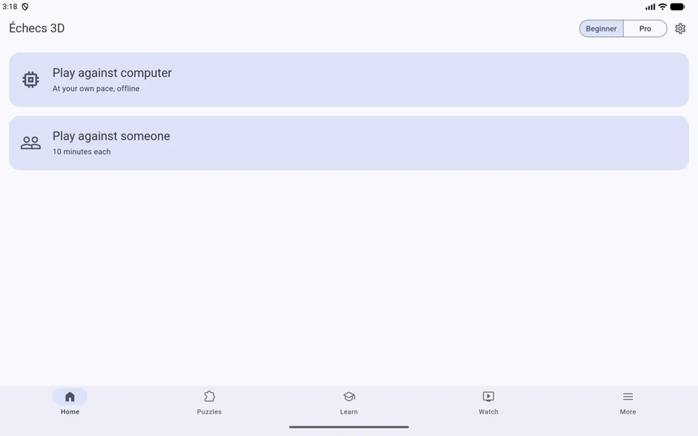
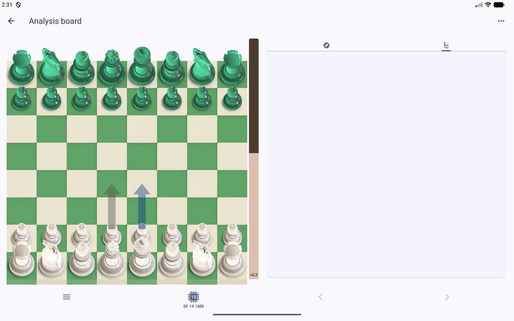

# Échecs 3D

Échecs 3D est une version modifiée (un « fork ») de [Lichess Mobile](https://github.com/lichess-org/mobile),
l'application libre de [lichess.org](https://lichess.org). Ce n'est **pas** une application officielle
de Lichess.

Elle a été écrite avec l'aide de Claude Code, un outil d'intelligence artificielle d'Anthropic.

## Ce qui change par rapport à Lichess Mobile

- **Échiquier 3D**, comme le mode 3D du site lichess.org : mêmes images de plateaux et de pièces
  (10 jeux de pièces, 19 plateaux), au choix dans Réglages → Thème → « 3D mode ».
- **Accueil pour débutants** : deux gros boutons, « Jouer contre l'ordinateur » et
  « Jouer contre quelqu'un » (10 minutes chacun). Un mode « Pro » affiche toutes les cadences.
- **Pas de compte** : on joue sans se connecter. La connexion à un compte Lichess est réservée à
  l'application officielle.

| Accueil débutant | Échiquier 3D |
| --- | --- |
|  |  |

## Code

- Application : ce dépôt, branche [`echecs-3d`](https://github.com/vascularia/mobile/tree/echecs-3d)
- Échiquier (chessground) : [`vascularia/flutter-chessground`, branche `board-3d`](https://github.com/vascularia/flutter-chessground/tree/board-3d)

Licence : GPL v3, comme Lichess Mobile. Les images 3D viennent de
[lila](https://github.com/lichess-org/lila/tree/master/public/images/staunton) (James Clarke, licence MIT).

Pour compiler l'APK Android :

```bash
flutter pub get
dart run build_runner build
flutter build apk --release
```
